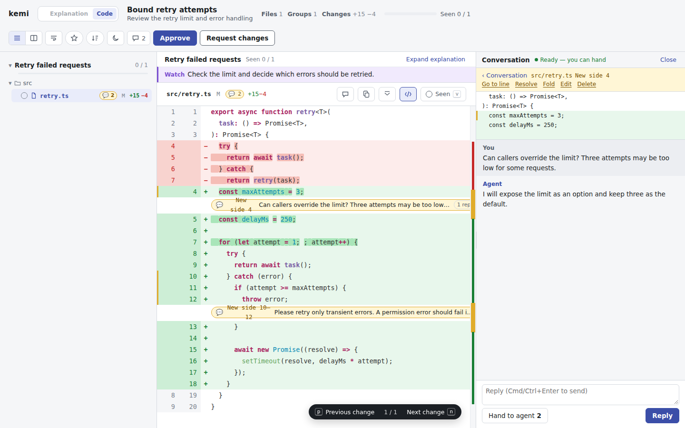
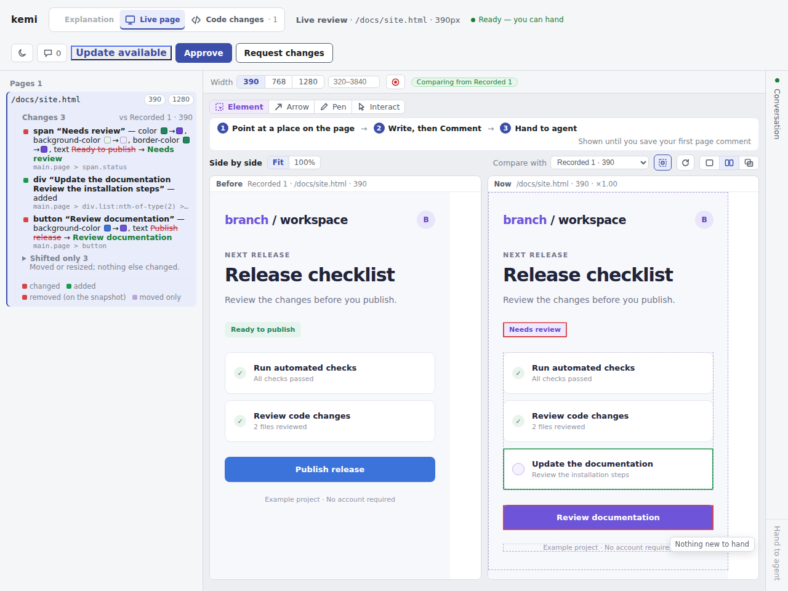

# kemi

[English](README.md) | 日本語

kemiは、ブラウザで変更内容をレビューし、コメントをJSONでターミナルへ返す道具です。
コードや文書、動いているWebページにコメントできます。
レビューを開いたまま、AIエージェントがフィードバックを読み、返信することもできます。

kemiはファイルを編集せず、修正案も適用しません。
単一のバイナリで動き、ブラウザ拡張は不要です。
名前は日本語の「閲する」に由来します。



サンプルの差分に行コメントを付け、エージェントとやり取りしている画面です。

## インストール

LinuxとmacOSでは[mise](https://mise.jdx.dev/)でインストールできます。

```sh
mise use -g github:ba0918/kemi
```

Windowsでは[GitHub Releases](https://github.com/ba0918/kemi/releases/latest)から対応するZIPをダウンロードします。
`kemi.exe`を取り出し、そのディレクトリを`PATH`に追加してください。

Linux・macOS・Windowsのx86_64とARM64に対応しています。
Linux向けのバイナリはmuslで静的リンクしています。
リポジトリをレビューするには、どのOSでも`PATH`からGitを実行できる必要があります。

## 変更をレビューする

Gitリポジトリのルートで次のコマンドを実行すると、未追跡ファイルを含む未コミットの変更をレビューできます。

```sh
kemi --worktree
```

1. 開いたブラウザで変更を読みます。ブラウザが開かない場合は、ターミナルに表示されたレビューURLを開いてください。
2. 行を選択し、コメントや置き換え案を書きます。
3. **Approve**（承認）または **Request changes**（変更要求）を押して終了します。

kemiは結果を1つのJSONとして標準出力に返し、終了します。
ファイルに保存する場合は、出力ファイルがレビュー対象にならないよう、リポジトリの外に置いてください。

```sh
kemi --worktree > ../review.json
```

| 終了コード | 意味 |
|---|---|
| `0` | 承認 |
| `1` | 変更要求 |
| `2` | 使い方・起動・実行中のエラー |
| `130` | レビュー送信前に中断 |

結果には承認・変更要求の判断、コメント、修正案、会話が含まれます。
JSONを処理する場合は[結果の参照資料](skills/kemi/references/results.md)を参照してください。資料は英語です。

## レビュー対象を選ぶ

| レビューしたいもの | コマンド |
|---|---|
| `main`と比較した現在のブランチの変更 | `kemi --from main` |
| 未追跡ファイルを含む未コミットの変更 | `kemi --worktree` |
| ステージ済みの変更 | `kemi --staged` |
| JSONのmanifestでグループ分けしたファイルや草稿 | `kemi manifest.json` |
| 標準入力から渡すmanifest | `kemi -` |

コミット範囲のレビューでは、変更を1つの差分にまとめ、各パスを1回ずつ表示します。
マージコミットを除き、コミットごとに読みたい場合は次のコマンドを使います。

```sh
kemi --from main --group-by commit
```

画面上で2つのグループ分けを切り替えられます。再起動は不要です。
範囲の終点を`HEAD`以外にする場合は`--to <ref>`を指定します。

Markdown・CSV・TSV・SVGでは、描画表示とソース表示を切り替えられます。
それ以外の画像は画像として表示します。

`--explanation <file>`で説明文書を添えられます。画面は差分より先に説明を表示します。
説明にもコメントでき、説明中のリンクからコードや動いているページを開けます。

変更が大きい場合は、`kemi --from main --digest`で行内容を含まない概要を出力できます。
レビュー画面を開かずに終了します。

## AIエージェントとレビューする

エージェントにレビューの起動方法と結果の読み方を伝えるスキルをインストールします。

```sh
gh skill install ba0918/kemi kemi
```

レビューURLを共有する前に、変更内容と判断してほしい点を説明するようエージェントに依頼してください。
エージェントはレビューの送信が終わるまでkemiを動かし続ける必要があります。
スキルをインストールし直すと、最新のタグ付きリリースの内容に更新できます。

レビューを送信する前に、変更について相談することもできます。
エージェントはkemiが表示するレビューIDを使ってフィードバックを待ち、返信を送ります。

```sh
kemi wait <id>
kemi reply <id> < writes.json
```

画面でコメントを書き、**Hand to agent**を押すとまとめてエージェントへ渡せます。
このボタンは、エージェントが一度`kemi wait`を呼ぶと使えるようになります。
返信は会話パネルに表示されます。
`Approve`または`Request changes`を押すまでレビューは続きます。

返信の形式、タイムアウト、エージェント用コマンドの終了コードは、英語の[会話の参照資料](skills/kemi/references/conversation.md)を参照してください。

## 動いているページをレビューする

開発サーバを起動してから、次のコマンドを実行します。

```sh
kemi --live http://localhost:5173/
```

手元のHTMLファイルもレビューできます。

```sh
kemi --live docs/mock.html
```

**Live page**タブでは表示幅を変えてページを確認できます。
保存したスナップショットやHTMLのモックと比較できます。
Element・Arrow・Penで場所を指定してコメントしてください。

Gitリポジトリ内で起動すると、**Code changes**タブに作業ツリーの差分が表示されます。
スマートフォンではタブ名が **Page**と **Code**になります。



サンプルページと保存したスナップショットを並べ、変更した要素に印を付けた画面です。

URLは`localhost`または`127.0.0.1`などのIPv4ループバックアドレスで、HTTPを使う必要があります。
手元のHTMLファイルはリポジトリ内に置いてください。
リポジトリの外で起動する場合は、起動したディレクトリ内に置きます。
共有するのはレビューURLです。別に表示される`kemi: live`のURLではありません。

コメント画像に必要な資源を埋め込めない場合は、画像なしでコメント本文と場所を保存し、その理由を表示します。
併用できるオプションや比較方法は、英語の[live入力の説明](skills/kemi/references/inputs.md#reviewing-a-running-page)を参照してください。

## レビューの再開と結果の取り直し

Ctrl+Cでレビューを中断した後は、次のコマンドで再開できます。

```sh
kemi --resume          # ターミナルで保存済みレビューを選ぶ
kemi --resume <id>     # レビューIDを指定して、どのディレクトリからでも再開する
```

コードやmanifestのレビューでは、ファイルが変わっていても元の差分を復元します。
再開できるのは、kemiがレビューの写しを容量上限内で保存し終えた場合だけです。
動いているページのレビューでは、現在の作業ツリーを読み直します。
保存容量の上限や復元する内容は、英語の[再開の参照資料](skills/kemi/references/resume.md)にあります。

送信済みの結果は別に保存されます。
現在のリポジトリで最後に送信した結果を取り出すには、次のコマンドを使います。

```sh
kemi --result
```

## 別の端末から開く

既定では、kemiを起動したマシンからだけレビューに接続できます。
ポートを固定し、すべてのIPv4ネットワークインターフェースで接続を受け付けるには、次のように起動します。

```sh
kemi --worktree --bind 0.0.0.0 --port 3000
```

kemiが表示するネットワーク用のURLを使ってください。
そのポートに接続でき、URLを知っている人は、変更を読んでレビューを送信できます。
接続は暗号化されていないHTTPです。
`--live`では開発中のページも公開します。

ファイアウォールやネットワークの設定によっては、接続できないことがあります。
WSL2ではWindows側のファイアウォールやポート転送の設定も必要になる場合があります。
kemiはこれらの設定を変更しません。

## 参照資料

以下の英語の参照資料は、エージェント向けスキルに付属しています。
正式な仕様は`docs/spec/`にあり、日本語で書かれています。

| 調べたいこと | 参照先 |
|---|---|
| 入力モード、フラグ、manifest、focusファイル、digest | [入力の参照資料](skills/kemi/references/inputs.md)（英語） |
| エージェントの返信とフィードバックの受け渡し | [会話の参照資料](skills/kemi/references/conversation.md)（英語） |
| 説明文書に書く内容と図の雛形 | [説明文書の書き方](skills/kemi/references/explanation-writing.md)（英語） |
| 説明文書のJSON、参照、更新 | [説明文書の参照資料](skills/kemi/references/explanation.md)（英語） |
| 結果のJSONと保存済みの結果 | [結果の参照資料](skills/kemi/references/results.md)（英語） |
| 中断したレビューと保存済みセッション | [再開の参照資料](skills/kemi/references/resume.md)（英語） |
| 画面の詳しい操作、描画表示、キーボードショートカット | [読み進める操作](docs/spec/reading.md)、[描画表示](docs/spec/render.md)、[狭い画面](docs/spec/narrow.md) |
| 動いているページの比較とコメント | [動いているページのレビュー](docs/spec/live.md)、[比較](docs/spec/live-compare.md) |
| 仕様と画面の参考資料の一覧 | [文書の索引](docs/README.md) |
| リリースごとの変更 | [変更履歴](CHANGELOG.md) |

コマンドラインの使い方は`kemi --help`で確認できます。

## 開発

UIはJavaScriptのネイティブモジュールとCSSで構成し、フロントエンドのビルド工程はありません。
UIとCLIの文言は英語、仕様書は日本語です。

```sh
cargo build --release
cargo test --workspace --locked
node --test web
npx tsc -p web --noEmit
```

リポジトリの構成やその他の検査は[PROJECT.md](PROJECT.md)を参照してください。

## ライセンス

MIT OR Apache-2.0です。[LICENSE-MIT](LICENSE-MIT)と[LICENSE-APACHE](LICENSE-APACHE)を参照してください。
